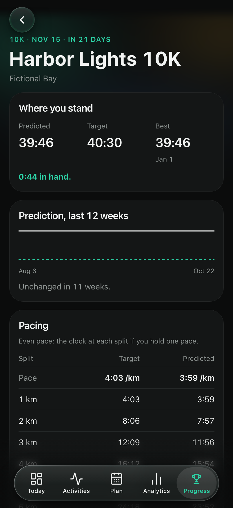
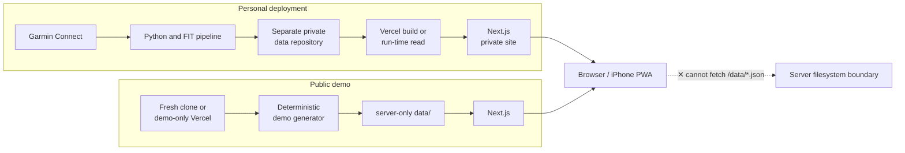

# RunOmics

Privacy-first running analytics, built as an iPhone web app with Next.js and Garmin data.

RunOmics is a self-hosted training app: today's load and session, every run in detail,
a plan, analytics and a Progress hub with the next race, goals, records and explored
ground. A Python pipeline synchronizes a personal Garmin history into a separate private
data repository. A fresh clone instead generates a deterministic, fictional season, so
the whole app can be reviewed without an account, an API key or a database.

[Live demo](https://runomics-demo.adamelkadaoui.com/) · [Features](#features) · [Tech stack](#tech-stack) · [Architecture](#architecture)

## Live demo

**[Open the live demo](https://runomics-demo.adamelkadaoui.com/)**, best on a phone or in a
narrow window: the app is designed for an iPhone's home screen. Every athlete, activity,
shoe, race and route in it is generated; the routes are drawn in the open Pacific.

| Today | Activity | Analytics |
| --- | --- | --- |
|  |  |  |
| **Plan** | **Race** | **Records** |
|  |  |  |

All screenshots come from the repository's synthetic dataset.

## Features

- **Today** - the day's verdict on training load (CTL/ATL/TSB, the 7-day load against
  a safe range), today's planned session with what a warm forecast will cost at your
  usual hour, the week's volume against the plan, and an owner-only morning check-in
  (sleep, soreness, stress, mood, niggles) that tempers the readiness verdict
- **Activity detail** - route map synced with the HR, pace and elevation charts, splits,
  heart-rate zones, training effect, running dynamics against your usual, weather, the
  shoe, a run verdict and a shareable PNG card; grade-adjusted pace on hilly runs, and
  each controlled-threshold rep's heart rate against its target
- **Activities** - the full history as a list with filters, or as a heatmap of every
  route with a home-area summary
- **Plan** - week and month views of planned and completed sessions, cross-training
  beside the runs, the block's phases, a Coach card with the latest decision and the next
  key session, an optional adaptive coach (a local CLI, Gemini) that writes the next four
  weeks, and a 12-week checkpoint that sets each cycle against the one before
- **Analytics** - load, performance, volume and intensity over 4 weeks, 12 weeks or a
  year: form, training status and load focus, VO₂max, threshold pace and heart rate, a
  pace-duration curve with critical speed, running form and heart-rate trends, the 80/20
  easy-hard split
- **Race page** - the next race: Garmin's prediction (or a VDOT estimate from your best
  recent effort) against your target and best, its 12-week trend, and even splits at both
  times
- **Progress** - goals and the season's races, records and race predictions (Riegel),
  milestones, consistency streaks, shoes and their wear, all-time totals, athlete zones
  and fitness age
- **Explore** - quartier coverage on the map, a loop-route generator for the ground you
  have not run yet (OpenRouteService), GPX export, and the quartiers each run pushed forward
- **Built for the phone** - an installable PWA with iOS-style Liquid Glass surfaces,
  light and dark themes, accent palettes, offline pages and an update on resume
- **English and French** - the language is picked at build time

## Engineering highlights

- **Next.js 16 App Router and React 19** with server components, client islands,
  static generation and hourly ISR
- **TypeScript in domain-oriented layers**: pure training rules, use cases,
  repositories and presentation, with an import-cycle check
- **Server-only JSON repositories** for activity data: no activity database, and no
  dataset served from `public/`
- **Deterministic demo mode** that generates 18 months of fictional training, races,
  shoes, a coaching plan and an explorable area from a fixed seed
- **Python Garmin and FIT pipeline**: Garmin's Personal API, FIT parsing, metric
  extraction, weather enrichment and route simplification, with a data contract shared
  with the TypeScript reader
- **Private data separation** through an independent repository fetched at build time
  or read at run time through GitHub's API
- **MapLibre maps** on RunOmics' own greyscale MapTiler styles, so the runs are the only
  colour on the map
- **Optional private site**: with `RUNOMICS_PRIVATE`, every page and API answers only to
  the owner or invited Google accounts, through a signed session cookie checked in the proxy
- **Optional Firebase and Gemini integrations** for owner-only settings, notes, push
  notifications and AI-written insights; every screen falls back to rules-based copy
- **Security controls**: CSP headers, internal API authentication, a scan for committed
  data and credentials, and client error reports scrubbed of coordinates
- **Vitest, Testing Library, Playwright (Chromium and WebKit at iPhone size), pytest and
  axe-core** for rules, repositories, components, accessibility and browser workflows

## Architecture



At render time, server components call application use cases, which read plain JSON
through infrastructure repositories. Only serializable summaries cross into interactive
client components; GPS traces and sample arrays stay on the server except on the one
activity page that draws them.

```text
src/domain/                       Models and pure training rules
src/application/                  Use cases, coaching and render-time aggregation
src/infrastructure/               Server-only JSON, Firestore and AI adapters
src/app/                          Next.js routes, API routes and server components
src/components/                   Feature UI and client-side interaction
scripts/                          Demo generator, Garmin/FIT pipeline, map and explore builders
```

## Privacy and security design

- The demo runs entirely on a generated, fictional dataset: athlete values, activity
  and gear ids, routes, races and places.
- Real datasets live in a separate private repository and are never committed here.
- Runtime JSON lives in repository-root `data/`, outside `public/`, and is read only by
  server-side modules.
- Credentials belong in local environment files, GitHub Actions secrets or the Vercel
  project, never in the repository.
- This repository is a curated export of a private codebase: the export drops the
  personal deployments' workflows and tooling, and stops on names, ids, places or races
  that belong to a real athlete. `scripts/verify_no_private_data.mjs` checks every
  tracked file for data directories, activity binaries and credential shapes.

RunOmics is an independent project and is not affiliated with or endorsed by Garmin.

## Quick start

Requirements: Node.js 22 or newer.

```bash
git clone https://github.com/adamkadev/RunOmics.git
cd RunOmics
npm install
npm run dev
```

Open [http://localhost:3000](http://localhost:3000), ideally in a phone-sized window.
With no data source configured, the `predev` hook runs `scripts/prepare-data.mjs`, which
generates the demo dataset in `data/`. The same hook runs before build, lint, typecheck
and unit tests, and does nothing once the directory is populated.

To recreate the demo dataset:

```bash
rm -rf data
npm run prepare:data
```

`data/` is gitignored. Never move it under `public/` or commit it.

## Demo-only Vercel deployment

Import this repository into a dedicated Vercel project with the default Next.js
settings, and configure no data source: the build generates the synthetic dataset and
then builds the app.

The demo needs no secret. Leave out every personal credential: Garmin, the data
repository, Firebase, notifications, `RUNOMICS_PRIVATE` and `SESSION_SECRET`.

| Optional setting | Behavior when absent |
| --- | --- |
| `NEXT_PUBLIC_MAPTILER_TOKEN` | Maps say "Map unavailable"; every other screen works. |
| `NEXT_PUBLIC_ALLOW_INDEXING` | Search engines are kept out. Set `true` only on a public demo. |
| `NEXT_PUBLIC_FIREBASE_*` | Sign-in, notes and notifications say they are not available. |
| `GEMINI_API_KEY` | AI calls are skipped and the rules-based insights remain. |
| `ORS_API_KEY` | The route generator says it is not set up on this deployment. |
| `NEXT_PUBLIC_LOCALE` | English; set `fr` for the French build. |

## Personal data pipeline

Personal deployments are optional and kept apart from demo mode:

1. A Python job reads new runs through Garmin's Personal API and downloads their FIT files.
2. The pipeline derives activity metrics, downsamples chart series and adds the weather.
3. The JSON is pushed to a separately secured data repository.
4. Vercel fetches that repository at build time into server-only `data/`, or reads it at
   run time through GitHub's API.

The scheduled sync and reminder workflows belong to the personal deployments and are not
part of this repository. See [.env.example](.env.example) for the configuration and
[scripts/](scripts/) for the pipeline's entry points.

## Tech stack

| Area | Technology |
| --- | --- |
| Web | Next.js 16, React 19, TypeScript |
| UI | Tailwind CSS v4, hand-drawn SVG charts, Lucide, next-themes |
| Maps | MapLibre GL, MapTiler, OpenRouteService |
| Data processing | Python, Garmin Personal API, Garmin FIT SDK, Open-Meteo |
| Optional services | Firebase, Gemini, Vercel Analytics and Speed Insights |
| Testing | Vitest, Testing Library, Playwright, axe-core, pytest |
| Delivery | GitHub Actions, Vercel, ISR, PWA service worker |

## Testing and quality

```bash
npm run verify        # private-data scan, lint, typecheck, import cycles, unit tests
npm run test:coverage
npm run build
python -m pytest scripts/tests/ -q
npm run test:e2e      # Playwright against a production build of the demo data
```

CI runs the Node checks, a production dependency audit, the Python tests and the
Firestore rules; the end-to-end suite runs on every push to `main`. No credentials are
needed for any of them.

## Screenshots

```bash
npm run screenshots             # visual-audit matrix of every page, gitignored output
npm run screenshots:portfolio   # the six README images, at the iPhone 16 Pro's size
```

The portfolio capture builds the demo dataset and shoots it in the dark theme with the
default accent. Set `SCREENSHOT_BASE_URL=https://runomics-demo.adamelkadaoui.com` to shoot the
live demo instead. See [screenshots/README.md](screenshots/README.md) for the audit run.

## Project history

[CHANGELOG.md](CHANGELOG.md) records the major product and engineering iterations.
RunOmics is released under the [MIT license](LICENSE).
