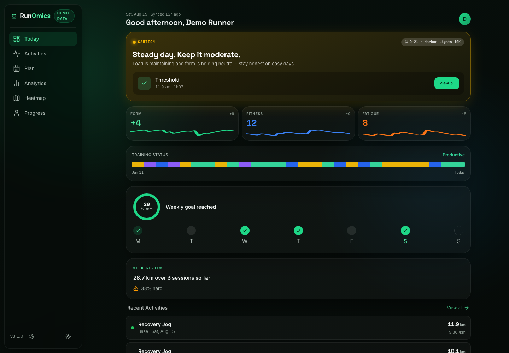
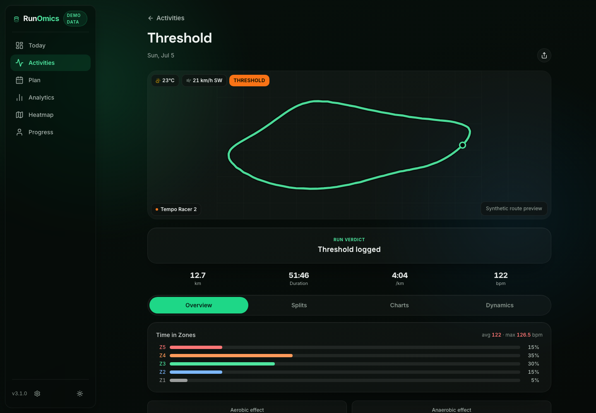
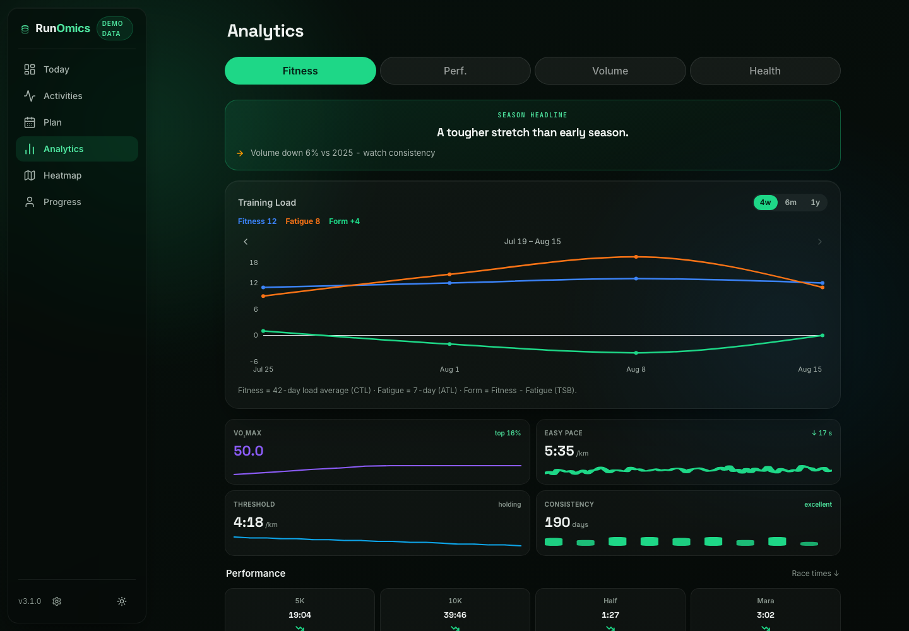
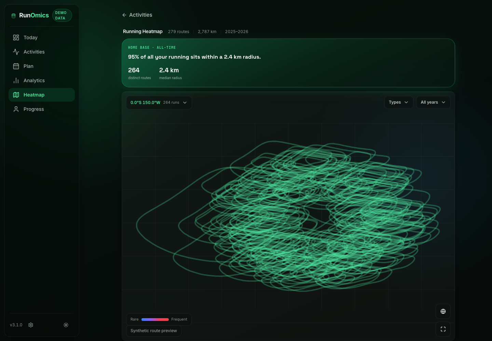
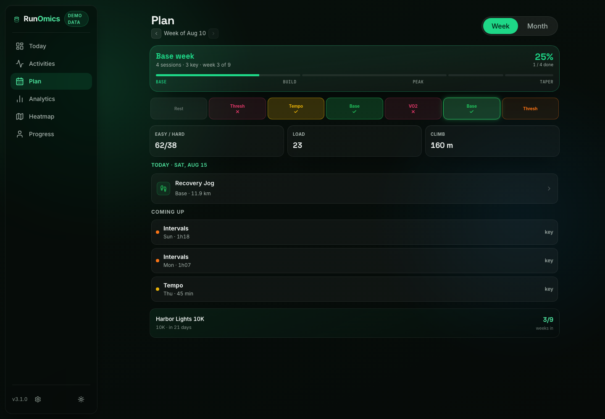
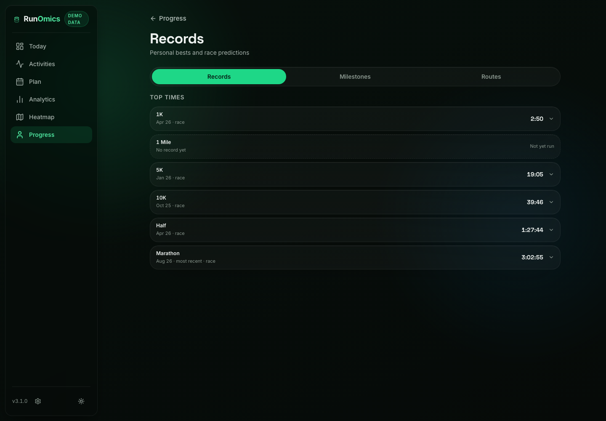
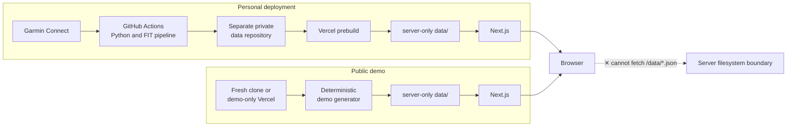

# RunOmics

Privacy-first running analytics dashboard built with Next.js and Garmin data.

RunOmics is a self-hosted dashboard for exploring training load, performance,
activities, routes and progress. A Python pipeline can synchronize a personal
Garmin Connect history while keeping the resulting dataset in a separate private
repository. A fresh clone instead generates a deterministic synthetic season, so
the complete application can be reviewed without an account, API key or database.

[Live demo](#live-demo) · [Tech stack](#tech-stack) · [Architecture](#architecture)

## Live demo

<!-- TODO: replace with public demo URL -->

**Demo deployment coming soon.** Until then, the local demo takes two commands and
contains only fictional athlete, activity, shoe and GPS data.



| Activity analysis | Fitness analytics |
| --- | --- |
|  |  |
| Route heatmap | Training plan |
|  |  |



All screenshots are generated from the repository's synthetic dataset.

## What it does

### Training and performance

- Tracks CTL, ATL and TSB to explain fitness, fatigue and form
- Shows VO2max, lactate-threshold and heart-rate-zone trends
- Breaks down training load, status and easy-to-hard distribution
- Surfaces race predictions and rules-based training insights

### Activity analysis

- Combines route, heart-rate, pace, cadence and elevation views
- Displays splits, best efforts, weather, training effect and running dynamics
- Estimates aerobic decoupling and finds similar runs
- Generates a shareable PNG summary card

### Planning

- Places completed and planned workouts on weekly and monthly views
- Shows training phases, weekly purpose and the next race
- Connects planned session types to athlete-specific pace zones

### Progress

- Collects personal bests, records, milestones and recurring routes
- Tracks annual goals against an eight-week rolling projection
- Monitors shoe mileage and wear thresholds
- Summarizes lifetime volume, consistency and athlete profile data

## Engineering highlights

- **Next.js 16 App Router and React 19** with server components, client islands,
  static generation and hourly ISR
- **TypeScript and domain-oriented layers** separating pure rules, use cases,
  repositories and presentation
- **Server-only JSON repositories** for activity data, with no activity database
  and no dataset shipped through `public/`
- **Deterministic demo mode** that produces 18 months of realistic fictional data
  from a fixed seed
- **Python Garmin and FIT pipeline** for activity ingestion, metric extraction,
  weather enrichment, route simplification and GPS privacy-zone cropping
- **Private data separation** through an independent repository hydrated only at
  build or synchronization time
- **MapLibre maps** with MapTiler basemaps when configured and a deterministic SVG
  route preview when no map token is available
- **Optional Firebase and Gemini integrations** for owner-only settings,
  notifications and cached AI summaries; the core dashboard works without either
- **GitHub Actions** for Node and Python CI, E2E checks and opt-in personal sync jobs
- **Vitest, Playwright, pytest and axe-core** for domain rules, repositories,
  components, accessibility and browser workflows
- **Security controls** including CSP headers, internal API authentication,
  secret scanning checks and a server-only data boundary

## Architecture



At render time, server components call application use cases, which read plain
JSON through infrastructure repositories. Only serializable summaries cross into
interactive client components. Large GPS traces and sample arrays remain on the
server except on the single activity detail page that needs them.

```text
src/domain/                       Models and pure training rules
src/application/usecases/         Render-time queries and aggregation
src/infrastructure/repositories/  Server-only JSON and optional Firestore adapters
src/app/                          Next.js routes and server components
src/components/                   Feature UI and client-side interaction
scripts/                          Demo generator and Garmin/FIT sync pipeline
```

## Privacy and security design

- Real Garmin data is never committed to this public source repository.
- A personal dataset can live in a separate private repository and be fetched into
  the deployment during prebuild.
- GPS trace endpoints can be cropped around configured privacy zones before an
  activity is stored.
- Runtime JSON lives in repository-root `data/`, outside Next.js `public/`, and is
  read only by server-side modules.
- The public demo dataset is fully synthetic, including athlete values, activity
  IDs, gear IDs, routes, races and locations.
- Credentials belong in local environment files, GitHub Actions secrets or Vercel
  project configuration, never in the repository.
- `scripts/verify_no_private_data.mjs` checks tracked files for data directories,
  activity binaries and common credential shapes.

RunOmics is an independent project and is not affiliated with or endorsed by Garmin.

## Quick start

Requirements: Node.js 20 or newer.

```bash
git clone https://github.com/adamkadev/RunOmics.git
cd RunOmics
npm install
npm run dev
```

Open [http://localhost:3000](http://localhost:3000). With no private-data variables,
the `predev` hook runs `scripts/prepare-data.mjs`, which creates the deterministic
dataset in `data/`. The same preparation hook runs before build, lint, typecheck and
unit tests, and becomes a no-op once the directory is populated.

To recreate the demo dataset:

```bash
rm -rf data
npm run prepare:data
```

`data/` is gitignored. Never move it under `public/` or commit it.

## Demo-only Vercel deployment

Import this repository into a dedicated Vercel project with the default Next.js
settings. Do not configure a private data source: the normal build command runs
`prepare-data`, generates the synthetic dataset and then builds the application.

The public demo should not receive personal deployment credentials, including Garmin,
private-repository, Firebase Admin, notification or real Firebase client values.
Gemini is also optional: without an API key, the interface keeps its deterministic
rules-based copy.

Set `NEXT_PUBLIC_ALLOW_INDEXING=true` only on the public portfolio deployment when it
is ready to appear in search results. Indexing remains disabled by default, which is
safer for personal self-hosted deployments.

| Optional setting | Behavior when absent |
| --- | --- |
| `NEXT_PUBLIC_MAPTILER_TOKEN` | Maps show a deterministic route preview without a basemap. |
| `NEXT_PUBLIC_FIREBASE_*` | Sign-in, notes and notifications stay disabled; read-only analytics still work. |
| `GEMINI_API_KEY` | AI calls are skipped and rules-based insights remain visible. |
| `NEXT_PUBLIC_LOCALE` | English is used; set `fr` for the French build. |

## Personal data pipeline

Personal deployments are optional and deliberately separate from demo mode. The main
workflow is:

1. A Python job authenticates to Garmin Connect and downloads new activity FIT files.
2. The pipeline derives activity metrics, downsamples chart series, enriches weather
   and crops configured GPS privacy zones.
3. JSON output is pushed to a separately secured data repository.
4. Vercel fetches that repository during prebuild into server-only `data/`.

The synchronization workflows are manual-only in this public repository, fail fast
when required secrets are missing and can be scheduled by a self-hoster after a manual
run succeeds. See [.env.example](.env.example) for placeholder configuration and the
scripts under [scripts/](scripts/) for the pipeline entry points.

## Tech stack

| Area | Technology |
| --- | --- |
| Web | Next.js 16, React 19, TypeScript 5 |
| UI | Tailwind CSS v4, Recharts, Lucide, next-themes |
| Maps | MapLibre GL, optional MapTiler basemaps |
| Data processing | Python, Garmin FIT SDK, Open-Meteo |
| Optional services | Firebase, Gemini, Vercel Analytics and Speed Insights |
| Testing | Vitest, Testing Library, Playwright, axe-core, pytest |
| Delivery | GitHub Actions, Vercel, ISR |

## Testing and quality

```bash
npm run lint
npm run typecheck
npm test
npm run test:coverage
npm run build
python -m pytest scripts/tests/ -q
npm run test:e2e
node scripts/verify_no_private_data.mjs
```

CI runs the Node checks, production dependency audit, Python tests and Playwright
suite against generated demo data. No private credentials are required.

## Screenshots

```bash
npm run screenshots             # mobile visual-audit matrix, gitignored output
npm run screenshots:portfolio   # six tracked desktop portfolio images
```

The portfolio capture is fixed to a desktop viewport, English locale, dark theme and
the default accent. It builds against the synthetic dataset and does not require
external map or Firebase credentials. See [screenshots/README.md](screenshots/README.md)
for the broader visual-audit workflow.

## Project history

[CHANGELOG.md](CHANGELOG.md) records the major product and engineering iterations. The
repository intentionally carries no license yet; review the license choice before
redistributing or publishing a derivative.
